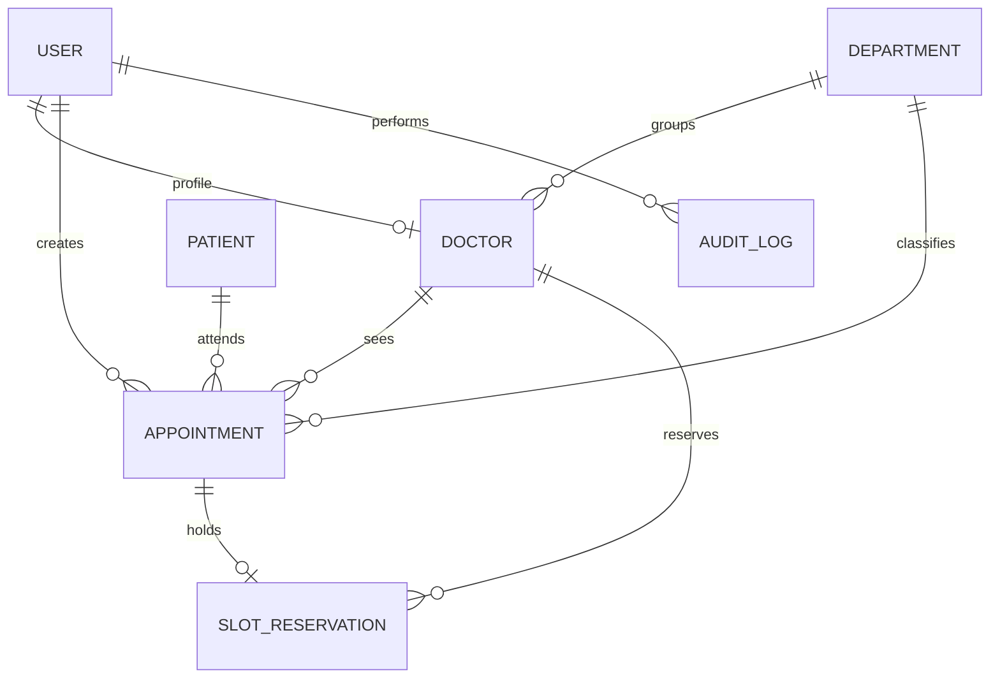

# Database schema

Active collections: `users` contains role-bearing identities, the optional doctor-profile reference, and the single active refresh-token hash/expiry. `doctors` owns professional information, the embedded weekly schedule (days, sessions, slot duration, breaks, and timezone), and a schedule revision used to force write conflicts between booking/rescheduling and schedule edits. `departments` contains department labels. `patients` contain normalized mobile numbers and registration identifiers. `appointments` reference patient, doctor, department, and creating user. `slotreservations` hold a unique `(doctor,startAt)` key for active slot ownership. `auditlogs` store actor/action/entity and minimal metadata; mutation events have a unique operation ID for idempotency. `DoctorSchedule` and `Session` model files are reserved for future effective-dated schedules and multiple concurrent login sessions; the current routes do not write those collections.

Indexes include unique user email, patient ID, doctor code, department name, audit operation ID, unique `(doctor,startAt)` reservation, and bounded appointment lookup indexes by doctor/date/status, department/status/date, and patient/date. Mobile numbers are normalized to digits with an optional leading plus before storage and indexed for front-desk lookup; patient name also has a lookup index. Booking, rescheduling, cancellation, schedule updates, and their audit writes run in MongoDB transactions. Booking/rescheduling and schedule updates both increment the doctor schedule revision, so concurrent transactions conflict and retry before validating the final schedule/reservations. The API requires a replica set or `mongos`; standalone MongoDB is rejected at startup.
